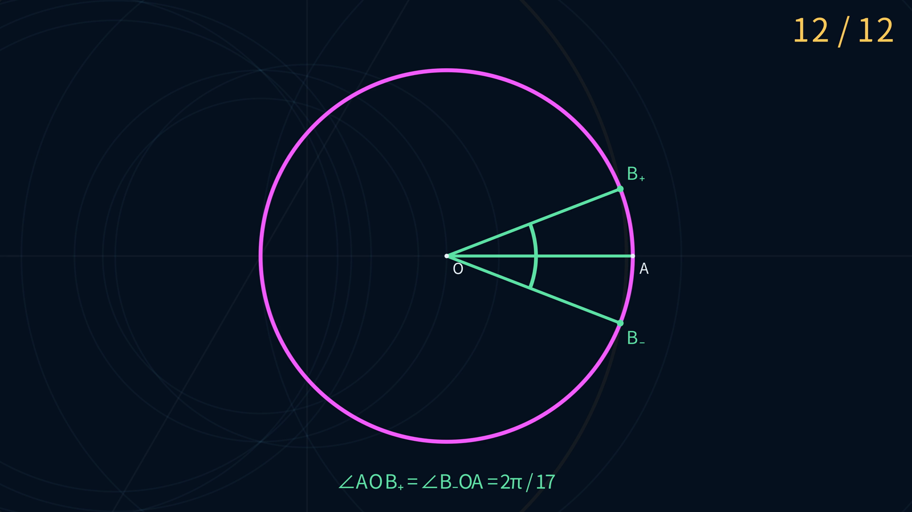

# Euclid-Min · A 12 E Regular 17-gon Construction

[简体中文](README.md) · **English**

**Construct both vertices adjacent to a given vertex of a regular 17-gon with 3 lines and 9 circles.**

This repository provides a step-by-step demonstration, an editable construction, a machine-replayable certificate, and independent exact checks. Both targets first appear at move 12, with no duplicate draws.

[Watch the 4K animation](animations/e12/E12Construction-4K.mp4) · [Offline interactive player](qq-ggb/web/README.md) · [GeoGebra construction](qq-ggb/ggb/README.md) · [Certificate](qq-ggb/construction-12e-011.json) · [Verification report](qq-ggb/verification-12e.json)

[](animations/e12/E12Construction-4K.mp4)

*Click the preview to view or download the animation: 3840 × 2160, 30 fps, approximately 49 seconds.*

## Explore the construction

| Format | File | Features |
|---|---|---|
| Manim animation | [4K MP4](animations/e12/E12Construction-4K.mp4) | All twelve moves, reference-point guides, and the final central angles |
| Offline web player | [Download index.html](qq-ggb/web/index.html) | Step playback, timeline navigation, pan and zoom, and certificate access |
| GeoGebra | [Download the .ggb file](qq-ggb/ggb/正十七边形-12E.ggb) | Move the initial points and inspect or edit native construction dependencies |

The web player is a self-contained HTML file. Download it and open it in a browser; no installation, network connection, or server is required. On GitHub, the HTML file link shows source code, so download the file first.

In the animation, magenta marks the free initial circle, gold the current move, pale blue the completed auxiliary objects, and green the result. Each circle is preceded by markers for its center and known circumference point, with a temporary radius guide. The green radii and angle arcs illustrate the result.

## What 12 E achieves

The center, a point on the circle, and the unit circle are given for free:

$$
O=(0,0),\qquad A=(1,0),\qquad \Gamma:x^2+y^2=1.
$$

The task is to construct either vertex adjacent to A in a regular 17-gon on the circle. This construction produces both:

$$
B_\pm=\left(\cos\frac{2\pi}{17},\ \pm\sin\frac{2\pi}{17}\right).
$$

Both central angles equal $2\pi/17$. The score stops when a target appears. Completing the remaining vertices or drawing the whole polygon is outside this count. **12 E is an exactly verified upper bound; global minimality has not been proved.**

### What counts as a move

| Operation | Cost |
|---|---:|
| Draw a line through two existing distinct points | 1 E |
| Draw a circle centered at an existing point through another existing point | 1 E |
| Obtain or name a determined intersection of existing lines and circles | 0 E |
| The given O, A, and initial circle | 0 E |

The tools are an unmarked straightedge and a **collapsing compass**, which cannot retain its opening to transfer a distance directly. Every new point must be a determined intersection of existing objects; arbitrary points are forbidden. Composite tasks such as constructing a midpoint, perpendicular, or parallel line must be expanded into elementary draws.

See the [fixed profile](profiles/regular-17-e-fixed-v1.yaml) and [metric specification](docs/METRICS.md) for the complete rules.

<details>
<summary>Show the twelve charged moves</summary>

Point labels match the demonstrations; U corresponds to `ggb_O` in the certificate. The [certificate](qq-ggb/construction-12e-011.json) records all intersection sources and branch indices. Intersection bindings are free.

| E | Object | Construction |
|---:|---|---|
| 1 | Line | Through A and O |
| 2 | Circle | Center C, through O |
| 3 | Circle | Center A, through C |
| 4 | Line | Through D and E |
| 5 | Circle | Center F, through G |
| 6 | Line | Through C and H |
| 7 | Circle | Center I, through J |
| 8 | Circle | Center K, through J |
| 9 | Circle | Center C, through L |
| 10 | Circle | Center K, through M |
| 11 | Circle | Center N, through U |
| 12 | Circle | Center C, through P; its intersections with the initial circle are B₊ and B₋ |

</details>

## Source and project contribution

The underlying geometry comes from a [GGB file](qq-ggb/正17边形.ggb) supplied through a QQ discussion group. Its original creator and earliest publication remain unconfirmed. Euclid-Min enumerated three intersection branch choices and changed the K and P branches so that the same twelve moves directly produce the two vertices adjacent to the fixed initial point A. The project also supplies the certificate, independent checks, and demonstrations.

See the [construction explanation](qq-ggb/README.md) and [source record](qq-ggb/source.yaml) for the original material, branch choices, and attribution.

## Exact verification

The verifier starts from the given objects, recomputes the construction, and independently counts the draws and first target appearance. It does not rely on displayed decimal coordinates or trust the certificate's asserted score.

| Check | Result | Record |
|---|---|---|
| Project exact verifier | 3 lines, 9 paid circles, both targets first reached at 12 E, no duplicate draws | [Verification report](qq-ggb/verification-12e.json) |
| Independent radical check | No project-code imports; circle equations, nested radicals, and the seventeenth root of unity checked; all 20 checks passed | [Radical report](qq-ggb/independent-12e-report.json) |
| Independent certificate replay | A separate exact intersection implementation matches all 18 named points and rejects four deliberately invalid inputs | [Independent replay report](qq-ggb/independent-certificate-report.json) |

Mathematical decisions use SageMath exact algebraic numbers. Numerical calculations in the web player and animation serve projection and playback; floating-point tolerances do not establish mathematical correctness.

## Reproduction

Use SageMath 10.7. From the repository root, the following command reads the existing certificate and prints a JSON report:

```sh
docker run --rm --network none \
  -v "$PWD:/workspace:ro" -w /workspace \
  -e PYTHONPATH=/workspace/sage -e PYTHONDONTWRITEBYTECODE=1 \
  sagemath/sagemath@sha256:4f5589eb6c565949a006f8665de2876b8414410daf5ac554f4434a15d4f3d528 \
  sage -python -m euclid_min verify \
  --profile profiles/regular-17-e-fixed-v1.yaml \
  qq-ggb/construction-12e-011.json --json
```

The key report fields should be:

```json
{
  "valid": true,
  "draw_operations": {"lines": 3, "circles": 9, "total": 12},
  "duplicate_draws": 0,
  "first_target_e_move": 12,
  "targets": ["B_plus", "B_minus"]
}
```

See the [12 E reproduction instructions](qq-ggb/README.md#复现) for independent checks and branch enumeration. Rebuild the demonstrations using the instructions for [Manim](animations/e12/README.md#重新生成), the [web player](qq-ggb/web/README.md#重新生成), and [GeoGebra](qq-ggb/ggb/README.md#重新生成).

## License and citation

Software, tests, configuration, and schemas use [Apache 2.0](LICENSE). Project mathematical documents, certificates, data, and animation outputs use [CC BY 4.0](LICENSE-CONTENT). Third-party material retains its own rights; see the [license scope](LICENSE-SCOPE.md). Cite [CITATION.cff](CITATION.cff) and the commit or version used.
