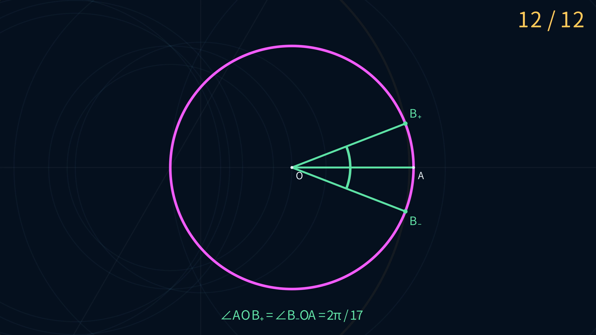

# Euclid-Min · 正十七边形 12 E 尺规构造

**简体中文** · [English](README.en.md)

**用 3 条直线和 9 个圆，构造给定圆上一点的两个正十七边形相邻顶点。**

本项目提供这份 12 E 构造的逐步演示、可编辑图形、机器可重放证书与独立精确核验。两个目标点首次同时出现在第 12 E，无重复绘制。

[观看 4K 动画](animations/e12/E12Construction-4K.mp4) · [离线交互网页](qq-ggb/web/README.md) · [GeoGebra 构造](qq-ggb/ggb/README.md) · [构造证书](qq-ggb/construction-12e-011.json) · [验证报告](qq-ggb/verification-12e.json)

[](animations/e12/E12Construction-4K.mp4)

*点击预览图查看或下载动画：3840 × 2160，30 fps，约 49 秒。*

## 先看演示

| 形式 | 入口 | 可以做什么 |
|---|---|---|
| Manim 动画 | [4K MP4](animations/e12/E12Construction-4K.mp4) | 看完十二笔作图、定位点提示和最终圆心角 |
| 离线网页 | [下载 index.html](qq-ggb/web/index.html) | 逐笔播放、前后跳转、平移缩放、查看证书 |
| GeoGebra | [下载 .ggb 文件](qq-ggb/ggb/正十七边形-12E.ggb) | 拖动初始点，查看和编辑原生尺规依赖 |

网页是一个自包含 HTML 文件，下载后直接用浏览器打开，无需安装依赖、联网或启动服务器。在 GitHub 上请先下载文件；点击仓库中的 HTML 链接会显示源码。

动画中的洋红色圆是免费给定的初始圆，金色表示当前一笔，淡蓝色表示已完成的辅助图元，绿色表示最终结果。每次画圆前都会标出圆心和圆上一点，并显示临时半径。绿色半径与角度弧只用于解释结果。

## 12 E 完成了什么

免费给出圆心、圆上一点和单位圆：

$$
O=(0,0),\qquad A=(1,0),\qquad \Gamma:x^2+y^2=1.
$$

目标是在圆上构造 A 的任意一个正十七边形相邻顶点。这份构造同时得到两点：

$$
B_\pm=\left(\cos\frac{2\pi}{17},\ \pm\sin\frac{2\pi}{17}\right).
$$

两点对应的圆心角均为 $2\pi/17$。计数在目标点出现时结束，不包含补齐其余顶点或连接整个多边形的工作。**12 E 是已精确验证的构造上界，尚未证明全局最小。**

### 什么算一步

| 操作 | 成本 |
|---|---:|
| 经过两个已有不同点画一条直线 | 1 E |
| 以一个已有点为圆心、经过另一个已有点画圆 | 1 E |
| 求出或命名已有直线与圆的确定交点 | 0 E |
| 免费给定的 O、A 和初始圆 | 0 E |

采用无刻度直尺和**塌圆规**：圆规不能保持开口来直接搬运距离。除初始点外，新点必须来自已有图元的确定交点；不允许任取点。作中点、垂线、平行线等复合操作必须展开为实际画线和画圆，不能各自算成一步。

完整规则见 [固定配置](profiles/regular-17-e-fixed-v1.yaml)和[计分规范](docs/METRICS.md)。

<details>
<summary>展开查看十二个计费动作</summary>

点名与演示一致；U 对应证书中的 `ggb_O`。交点的来源和分支索引完整记录在[构造证书](qq-ggb/construction-12e-011.json)中，交点绑定不计 E。

| E | 类型 | 作图 |
|---:|---|---|
| 1 | 直线 | 经过 A、O |
| 2 | 圆 | 以 C 为圆心，经过 O |
| 3 | 圆 | 以 A 为圆心，经过 C |
| 4 | 直线 | 经过 D、E |
| 5 | 圆 | 以 F 为圆心，经过 G |
| 6 | 直线 | 经过 C、H |
| 7 | 圆 | 以 I 为圆心，经过 J |
| 8 | 圆 | 以 K 为圆心，经过 J |
| 9 | 圆 | 以 C 为圆心，经过 L |
| 10 | 圆 | 以 K 为圆心，经过 M |
| 11 | 圆 | 以 N 为圆心，经过 U |
| 12 | 圆 | 以 C 为圆心，经过 P，与初始圆相交得到 B₊、B₋ |

</details>

## 来源与项目贡献

几何主体来自 QQ 讨论组网友提供的 [GGB 文件](qq-ggb/正17边形.ggb)，原作者和最初公开出处尚未确认。本项目枚举三个交点的分支选择，调整 K、P 两点的分支，使相同的十二笔直接得到固定初始顶点 A 的两个相邻顶点，并完成证书、独立核验和演示。

原始材料、分支选择与贡献范围见 [12 E 构造说明](qq-ggb/README.md)和[来源记录](qq-ggb/source.yaml)。

## 为什么可以确认是 12 E

验证器从初始对象出发，重新计算全部构造，重算步数和目标出现时刻。它不依赖画面上的近似坐标，也不直接采信证书声明的分数。

| 核验 | 结果 | 记录 |
|---|---|---|
| 项目精确验证器 | 3 条直线、9 个付费圆，首次在 12 E 命中两个目标，0 次重复绘制 | [验证报告](qq-ggb/verification-12e.json) |
| 独立根式核验 | 不导入项目代码，核对圆方程、嵌套根式与第十七次单位根，20 项检查通过 | [根式核验报告](qq-ggb/independent-12e-report.json) |
| 独立证书重放 | 使用另一套精确求交实现，全部 18 个具名点一致，4 个错误对照被拒绝 | [独立重放报告](qq-ggb/independent-certificate-report.json) |

数学判断使用 SageMath 精确代数数。网页与动画只在屏幕投影和播放时使用数值计算，不以浮点容差判断构造是否成立。

## 复现

使用 SageMath 10.7。从仓库根目录运行以下命令，只读取现有证书并输出 JSON 报告：

```sh
docker run --rm --network none \
  -v "$PWD:/workspace:ro" -w /workspace \
  -e PYTHONPATH=/workspace/sage -e PYTHONDONTWRITEBYTECODE=1 \
  sagemath/sagemath@sha256:4f5589eb6c565949a006f8665de2876b8414410daf5ac554f4434a15d4f3d528 \
  sage -python -m euclid_min verify \
  --profile profiles/regular-17-e-fixed-v1.yaml \
  qq-ggb/construction-12e-011.json --json
```

报告的关键字段应为：

```json
{
  "valid": true,
  "draw_operations": {"lines": 3, "circles": 9, "total": 12},
  "duplicate_draws": 0,
  "first_target_e_move": 12,
  "targets": ["B_plus", "B_minus"]
}
```

独立核验与分支枚举见 [12 E 复现说明](qq-ggb/README.md#复现)。重新生成演示见 [Manim](animations/e12/README.md#重新生成)、[网页](qq-ggb/web/README.md#重新生成)和 [GeoGebra](qq-ggb/ggb/README.md#重新生成)。

**Euclid 几何研究系列**

**Euclid-Min** · [Euclid-CCC-Min](https://github.com/lenovobenben/euclid-ccc-min) · [Euclid-Equal-Angle-Min](https://github.com/lenovobenben/euclid-equal-angle-min) · [Euclid-Castillon-Min](https://github.com/lenovobenben/euclid-castillon-min) · [Euclid-Conic-Classification](https://github.com/lenovobenben/euclid-conic-classification) · [Euclid-Cubic-Trisection](https://github.com/lenovobenben/euclid-cubic-trisection) · [Euclid-Square-Reconstruction](https://github.com/lenovobenben/euclid-square-reconstruction) · [Euclid-Fermat-Point](https://github.com/lenovobenben/euclid-fermat-point) · [Euclid-Quadrilateral-Centroid](https://github.com/lenovobenben/euclid-quadrilateral-centroid) · [Euclid-Quadrature](https://github.com/lenovobenben/euclid-quadrature)

## 许可与引用

代码、测试、配置和 Schema 使用 [Apache 2.0](LICENSE)；项目数学文档、证书、数据与动画使用 [CC BY 4.0](LICENSE-CONTENT)。第三方原始材料的权利不受本项目许可改变，详见[许可范围](LICENSE-SCOPE.md)。引用本项目时请使用 [CITATION.cff](CITATION.cff)，并注明所用提交或版本。
