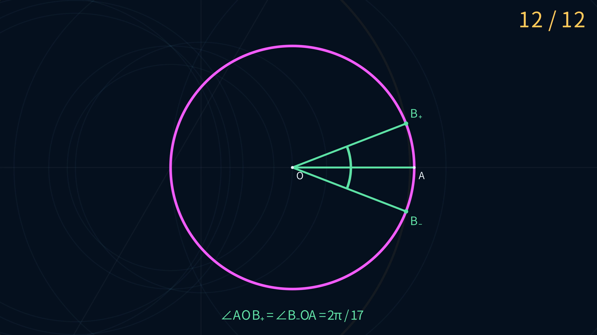

# 正十七边形 12 E · Manim 动画

[观看 4K MP4](E12Construction-4K.mp4) · [分镜](STORYBOARD.md) · [12 E 证书](../../qq-ggb/construction-12e-011.json)

[](E12Construction-4K.mp4)

成片为 3840×2160、30 fps，无配音。深蓝底、洋红初始圆、金色当前一笔、淡蓝旧图元、粉色圆心与临时半径提示，正片只保留几何标注和右上角 `00 / 12` 计数。每步显示两个定位点，镜头容纳当前图元及其定义点；圆的动画从给定圆上点开始。第十二笔同时得到 B₊、B₋，最后标注两个圆心角均为 2π/17。

几何线宽统一使用 `STROKE_SCALE = 2 / 3`，比初版调细约三分之一；文字和点标记保留原有大小。

几何主体来自 QQ 讨论组提供的 GGB 文件，原作者未确认。Euclid-Min 完成交点分支改写、证书、独立核验和动画。12 E 为已验证上界，未证明全局最小。绿色半径与角度弧是结果说明，计数在 12 E 即结束。

## 数据与源文件

- `export_geometry.py`：使用 Python 标准库验证网页精确导出数据的 SHA-256、证书内容、逐笔输入和点出生时刻，转换 SVG 向下的 y 轴为数学坐标。
- `geometry.json`：确定性生成的十二位十进制显示快照。
- `e12_construction.py`：Manim Community 0.21.0 场景 `E12Construction`。
- `Dockerfile`：固定 Manim 镜像并安装中文字体。
- `manim.cfg`：默认 4K、30 fps。
- `render-report.json`：本次成片参数、视频与场景摘要及关键帧检查记录。

上游网页数据由 Sage AA 精确重放实际证书，再与不导入项目代码的独立重放器比较全部 18 个点后生成。动画适配器不求交、不重新选择分支、不判定数学正确性；其浮点计算仅用于显示。

## 重新生成

从仓库根目录执行。证书未变化时直接适配已核验快照：

```sh
python3 animations/e12/export_geometry.py
```

若修改过证书，先按[网页说明](../../qq-ggb/web/README.md#重新生成)在 Sage 中重建上游数据，再运行上述命令。摘要不匹配时适配器会拒绝导出。

构建渲染环境：

```sh
docker build -t euclid-min-manim:0.21.0 animations/e12
```

快速预览：

```sh
docker run --rm --network none -v "$PWD:/manim" -w /manim \
  euclid-min-manim:0.21.0 \
  manim --config_file animations/e12/manim.cfg -ql \
  animations/e12/e12_construction.py E12Construction
```

4K 成片：

```sh
docker run --rm --network none -v "$PWD:/manim" -w /manim \
  euclid-min-manim:0.21.0 \
  manim --config_file animations/e12/manim.cfg --fps 30 \
  animations/e12/e12_construction.py E12Construction
cp animations/e12/media/videos/e12_construction/2160p30/E12Construction.mp4 \
  animations/e12/E12Construction-4K.mp4
```

`media/` 下的分段和缓存由 Git 忽略；交付 MP4 单独保存在本目录。原生环境可通过 `EUCLID_MIN_FONT` 指定已安装的中文字体，默认使用 `Noto Sans CJK SC`。修改场景后应先渲染低清预览检查构图，再生成 4K 并核对帧率和关键帧。
